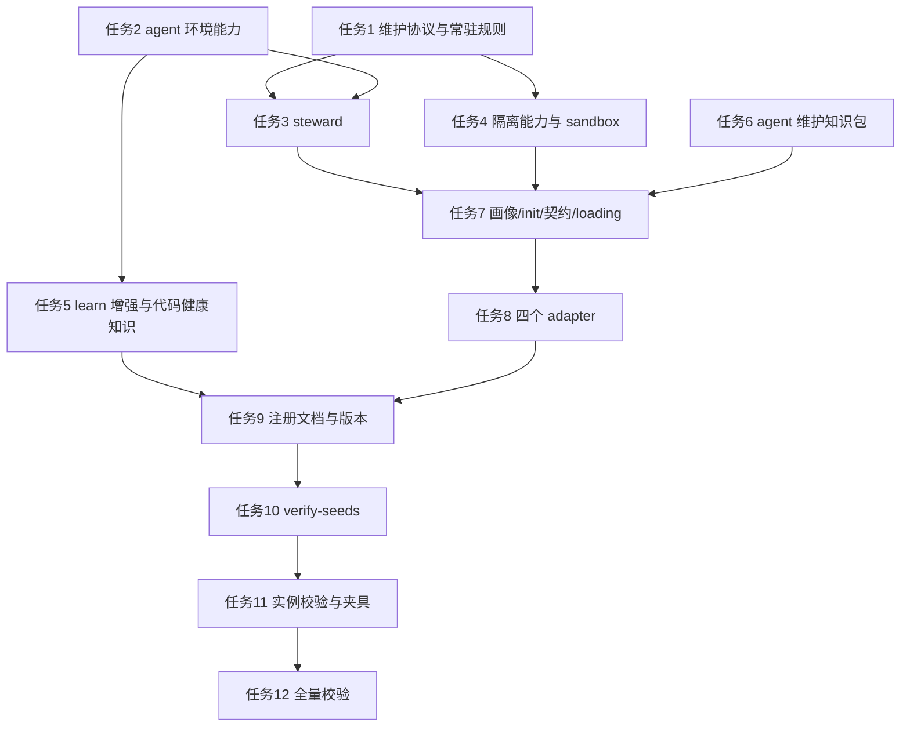

# agent 环境自检、learn 增强与隔离环境实施计划

**目标：** 在种子仓库中新增 agent 环境体检能力与隔离验证环境能力，增强 learn 的架构/反模式/死代码检测，并为 learn 与体检提供可落地的自动触发机制。

**背景：** 生成的目标项目缺少对 agent 自身环境（提示词、规则、技能、记忆、钩子、MCP、子代理）的周期性检查；learn 只能在用户显式说出“复盘”时触发；集成测试容易触碰共享或生产环境，阻塞验证。建成后，目标项目能用 `steward` 体检 agent 环境、用 `sandbox` 建立端到端可验证的隔离环境、用 `learn` 发现代码健康问题，并按平台能力选择钩子、云自动化或系统定时触发。

**架构：** 种子层新增两个 capability 与两个 skill；新增维护协议定义触发、节流、降级与钩子契约；新增常驻规则把“修复/发布/重构后 learn、按节奏 steward、E2E 前 sandbox”变成模型层硬约束；平台差异全部落在四个 adapter。learn 增加三个检测维度，并配一份平台无关的代码健康知识包。

**技术栈：** Markdown、YAML front matter、POSIX/Bash 校验脚本；不新增运行时依赖。

**计划状态：** 已批准并执行

**依据：**
- 用户需求：agent 环境检测种子、learn 增强、隔离环境种子、learn 自动触发、各 agent 定时能力研究。
- 现状文件：`seeds/en/capabilities/`、`seeds/en/skills/`、`protocols/en/`、`adapters/en/`、`scripts/verify-seeds.sh`、`scripts/verify-instantiation.sh`、`tests/fixtures/golden/`。
- Claude Code Hooks 官方文档：`https://code.claude.com/docs/en/hooks`（查询日期 2026-11-07），事件包含 `SessionStart`、`SessionEnd`、`UserPromptSubmit`、`Stop`、`StopFailure`、`PreToolUse`、`PostToolUse`。
- Claude Code 会话内定时工具 `CronCreate`（本机工具说明，2026-11-07）：标准 5 段 cron；持久化写入 `.claude/scheduled_tasks.json`；仅在 REPL 空闲时触发；循环任务 7 天后自动过期；最长延迟 30 分钟。
- Cursor Automations 官方博客：`https://cursor.com/cn/blog/automations`（2026-03-05），支持按计划或事件触发，运行在云端沙箱，可接 MCP、Webhook 与记忆工具。
- Codex Automations：多个公开来源确认存在“按计划/事件触发的云端 Codex 任务”；Codex CLI hooks 的配置位置与可用事件随版本变化，生成前必须核对当前版本，无法确认时降级。
- Claude Code Skill 触发链路的第三方观察（2026）：skill 由模型按 `description` 选择；会话启动时的 skill 清单有预算，预算不足会截断个人 skill 的 description；`paths` 可做确定性激活；`/name` 是显式调用。该结论作为设计依据，落地时仍需按版本验证。

## 非目标

- `steward` 不检测业务代码腐化；业务代码的架构、反模式、死代码问题交给 `learn` 与 `review`。
- 不自动修改规则、技能、记忆、提示词或 MCP 配置；只产出建议，应用前必须用户确认。
- 不执行任何删除操作；需要清理的资产移动到可恢复位置（废纸篓或归档目录）。
- 不在实现阶段真实创建平台定时任务或云端自动化；只生成配置模板与运行说明，创建动作需要用户在目标项目内明确授权。
- 不把某个容器、虚拟机、模拟器或云服务写成默认产品；种子层只写机制类别，具体产品由 adapter、技术包或目标项目决定。
- 不实现完整的静态分析引擎；确定性检查限于文件、配置、引用、预算、时间戳，语义判断由 agent 完成并附证据。
- 不改动现有 1.4.0 未提交改动的内容，只在其上增量集成。

## 全局约束

- `seeds/en/` 为权威，`seeds/zh/` 必须同结构、同标题、同表格形状、同文件数量。
- 种子层禁止出现平台路径（如 `.claude/`、`.cursor/`、`CLAUDE.md`、`.agents/`）与具体技术栈名称；平台落点只写进 `adapters/`。
- 常驻契约 ≤ 200 行；内联 core ≤ 60 行；路径规则与按需规则单文件 ≤ 120 行；skill `description` ≤ 500 字符；体检报告 ≤ 200 行。
- 版本号升级到 `1.5.0`；`CHANGELOG.md` 与 `CHANGELOG.zh.md` 同时增加条目。
- 所有校验命令必须通过：`scripts/check-format.sh`、`scripts/verify-seeds.sh --strict`、`scripts/test-fixtures.sh`。
- 未经用户明确允许，不执行 git commit、push、merge 或历史改写。
- 所有删除改为移动到废纸篓或归档目录；计划与报告中的“删除”均指可恢复清理。

## 复杂度追踪

无。本计划不违反 `AGENTS.md` 的硬性约束；新增常驻规则以单行摘要进入 core，需在实现后用行数校验确认未超预算。

## 假设

- 假设 A：当前工作区未提交的 1.4.0 改动是 1.5.0 的基线；若不成立，先停下核对用户希望保留的范围。
- 假设 B：Claude Code hooks 的行为以 2026-11-07 官方文档为准；若版本行为变化，按 `protocols/en/maintenance.md` 的降级路径处理。
- 假设 C：Codex CLI 的 hooks 配置随版本变化；若目标版本无法确认，Codex 只生成 `AGENTS.md` 规则 + `$steward` 显式调用 + 外部调度说明，不声称自动加载。
- 假设 D：Cursor 本地没有等价 hook；隔离与维护触发降级为 commands + Automations + 契约规则。
- 假设 E：用户接受“默认非阻塞提醒、按节奏体检”的交互方式；若觉得打扰，可把 `agent.maintenance_mode` 改为 `advisory` 或 `scheduled`。
- 假设 F：移动端、macOS、Windows 的隔离验证依赖模拟器/虚拟机；目标环境不具备时，`sandbox` 必须明确阻塞，不得伪造 E2E 结果。
- 假设 G：技能命名暂定 `steward` 与 `sandbox`；若用户希望改名，只替换名称与引用，不改变结构与职责。

## 取舍

| 决策 | 代价 | 什么证据会让我改主意 |
| --- | --- | --- |
| 新增 `steward` 与 `sandbox`，而不是塞进 `learn`/`agent-assets` | 多两个技能、两份 capability，注册与校验成本增加 | 如果用户更希望“一个技能包办”，或新技能长期不被触发，则合并回 `learn` |
| 常驻规则 + 平台钩子 + 可选定时，而不是只靠契约 | 需要生成平台配置，钩子可能产生噪音 | 如果钩子在真实项目中误报率高，改为默认 `advisory`，只保留定时 |
| 隔离环境容器优先、进程降级、虚拟机兜底 | 容器与虚拟机启动成本高，移动端/桌面端需要额外工具 | 如果进程级隔离已能覆盖主要 E2E，则把容器降为可选 |
| 确定性检查 + agent 语义判断 | 报告可能混有主观判断，需要证据字段约束 | 如果出现无法复现的结论，扩大确定性检查比例 |
| 代码健康知识包独立成篇 | 多一个文件与索引项，加载时需要判断 | 如果 `learn` 正文已足够且知识包无人读取，则合并进 `learn` |

## 交付分档

| 阶段 | 范围 | 交付标准 |
| --- | --- | --- |
| MVP | 任务 1-4 | 维护协议与常驻规则、agent 环境 capability+skill、隔离 capability+skill、learn 三维检测全部落盘，`verify-seeds --strict` 通过 |
| 完整版 | 任务 1-11 | 画像/init/契约/loading、四个 adapter、注册文档、校验脚本与 golden fixture 全部同步，三条校验命令通过 |
| 增强 | 后续 | 真实平台定时任务创建、虚拟机镜像模板、体检历史趋势、技能使用统计；不阻塞本次验收 |

## 存储与迁移

| 场景 | 行为 |
| --- | --- |
| 首次运行（无 `.agent/agent-health.md`） | `init` 创建基线报告，写明“尚未执行首次体检”和下次体检时间 |
| 旧格式项目（`seed_version < 1.5.0`） | 升级时补建 `.agent/agent-health.md`；校验脚本只告警，不失败 |
| 新版本项目（`seed_version >= 1.5.0`）缺少体检报告 | 校验失败，要求补建；报告是普通 Markdown，旧版本读取时忽略 |
| 旧版本程序读到新 profile 字段 | YAML 未知字段被忽略；新字段均有默认值，不破坏旧解析 |
| 新版本读到旧报告 | 旧报告按时间戳追加新章节，不覆盖历史结论；无法解析时保留原文并新建章节 |
| 回滚 | 把 `SEEDS_VERSION` 与 CHANGELOG 改回 1.4.0；新增文件移动到废纸篓；移除钩子配置中的维护条目；不删除用户已有报告 |

## 性能与资源预算

| 项 | 上限 | 超限行为 | 验收基线 |
| --- | --- | --- | --- |
| 维护钩子执行 | 2 秒 | 超时退出 0，不阻塞会话 | 冷启动本机 2 秒内返回 |
| 维护钩子网络访问 | 0 次 | 禁止联网 | 脚本内无网络命令 |
| 每会话提醒次数 | 1 次 | 已有提醒标记时静默 | 同一会话不重复提示 |
| `steward` 单次体检 | 5 分钟 | 超时输出已完成部分与未检查项 | 中型项目 5 分钟内产出报告 |
| 体检报告 | 200 行 | 超出时按严重度截断并写明细文件 | 报告可读，明细可追溯 |
| `sandbox` 启动 | 5 分钟 | 超时终止并给出失败原因 | 容器/进程环境 5 分钟内可用 |
| `sandbox` E2E | 10 分钟 | 超时终止并保留日志 | 超时输出失败命令与日志路径 |
| `sandbox` 拆除 | 2 分钟 | 超时列出残留资源 | 拆除后无容器、卷、临时目录残留 |
| 体检节奏 | 每周 1 次 | 超过 7 天未体检则在会话开始提醒 | 提醒只出现一次，执行后更新报告时间 |
| 提醒节流 | 24 小时 | 24 小时内不重复提醒 | 同日多次会话只提醒一次 |
| skill `description` | 500 字符 | 超出时截断并告警 | 触发关键词保留在开头 |

## 文件结构

| 文件 | 动作 | 职责 |
| --- | --- | --- |
| `protocols/en/maintenance.md` | 新建 | 维护触发、模式、节流、钩子契约、降级、验证 |
| `protocols/zh/maintenance.md` | 新建 | 中文镜像 |
| `seeds/en/rules/core/maintenance.md` | 新建 | MNT-01~04 常驻规则 |
| `seeds/zh/rules/core/maintenance.md` | 新建 | 中文镜像 |
| `seeds/en/capabilities/agent-environment.md` | 新建 | agent 环境体检能力定义 |
| `seeds/zh/capabilities/agent-environment.md` | 新建 | 中文镜像 |
| `seeds/en/skills/steward/SKILL.md` | 新建 | agent 环境体检与整理技能 |
| `seeds/zh/skills/steward/SKILL.md` | 新建 | 中文镜像 |
| `seeds/scaffolds/hooks/agent-maintenance` | 新建 | 会话开始/结束的轻量维护提醒脚本 |
| `seeds/en/capabilities/isolated-environment.md` | 新建 | 隔离验证环境能力定义 |
| `seeds/zh/capabilities/isolated-environment.md` | 新建 | 中文镜像 |
| `seeds/en/skills/sandbox/SKILL.md` | 新建 | 隔离环境创建与端到端验证技能 |
| `seeds/zh/skills/sandbox/SKILL.md` | 新建 | 中文镜像 |
| `seeds/en/knowledge/code-health.md` | 新建 | 架构、反模式、死代码检测目录 |
| `seeds/zh/knowledge/code-health.md` | 新建 | 中文镜像 |
| `seeds/en/knowledge/agent-maintenance.md` | 新建 | agent 腐化模式、证据、误报、验证 |
| `seeds/zh/knowledge/agent-maintenance.md` | 新建 | 中文镜像 |
| `seeds/en/knowledge/INDEX.md` | 修改 | 登记两个新知识包 |
| `seeds/zh/knowledge/INDEX.md` | 修改 | 中文镜像 |
| `seeds/en/skills/learn/SKILL.md` | 修改 | 增加架构/反模式/死代码检测 |
| `seeds/zh/skills/learn/SKILL.md` | 修改 | 中文镜像 |
| `seeds/en/capabilities/environment.md` | 修改 | 声明与 agent 环境体检的边界 |
| `seeds/zh/capabilities/environment.md` | 修改 | 中文镜像 |
| `seeds/en/capabilities/agent-assets.md` | 修改 | 声明与周期性体检的边界 |
| `seeds/zh/capabilities/agent-assets.md` | 修改 | 中文镜像 |
| `seeds/en/capabilities/dev-environment.md` | 修改 | 指向隔离验证能力 |
| `seeds/zh/capabilities/dev-environment.md` | 修改 | 中文镜像 |
| `seeds/en/capabilities/target-environment.md` | 修改 | 指向隔离验证能力 |
| `seeds/zh/capabilities/target-environment.md` | 修改 | 中文镜像 |
| `seeds/en/questions/project-profile.md` | 修改 | 新增维护与隔离字段、问题顺序 |
| `seeds/zh/questions/project-profile.md` | 修改 | 中文镜像 |
| `seeds/en/skills/init/SKILL.md` | 修改 | 生成体检基线、隔离决策、维护配置 |
| `seeds/zh/skills/init/SKILL.md` | 修改 | 中文镜像 |
| `seeds/en/docs/agent-contract.md` | 修改 | 常驻约定、加载表、技能索引、自学习 |
| `seeds/zh/docs/agent-contract.md` | 修改 | 中文镜像 |
| `protocols/en/loading.md` | 修改 | 维护协议引用与 L3 新文件 |
| `protocols/zh/loading.md` | 修改 | 中文镜像 |
| `adapters/en/claude-code.md` | 修改 | 钩子、会话定时、技能触发预算、资产路径 |
| `adapters/zh/claude-code.md` | 修改 | 中文镜像 |
| `adapters/en/cursor.md` | 修改 | Automations、无 hook 降级、资产路径 |
| `adapters/zh/cursor.md` | 修改 | 中文镜像 |
| `adapters/en/codex.md` | 修改 | Automations、hooks 版本核对、降级 |
| `adapters/zh/codex.md` | 修改 | 中文镜像 |
| `adapters/en/generic.md` | 修改 | 系统定时/CI 调度、显式调用降级 |
| `adapters/zh/generic.md` | 修改 | 中文镜像 |
| `CAPABILITIES.md` / `CAPABILITIES.zh.md` | 修改 | 新增能力与技能条目 |
| `README.md` / `README.zh.md` | 修改 | 技能与能力清单同步 |
| `AGENTS.md` / `AGENTS.zh.md` | 修改 | 目录职责与校验命令同步 |
| `CHANGELOG.md` / `CHANGELOG.zh.md` | 修改 | 1.5.0 条目 |
| `SEEDS_VERSION` | 修改 | 1.5.0 |
| `scripts/verify-seeds.sh` | 修改 | 新文件/协议/适配器章节/学习关键词校验 |
| `scripts/verify-instantiation.sh` | 修改 | 体检报告、维护字段、钩子配置的版本感知校验 |
| `scripts/test-fixtures.sh` | 修改 | 维护钩子脚本测试与缺失体检报告测试 |
| `tests/fixtures/golden/.agent/profile.yaml` | 修改 | 新增维护与隔离字段 |
| `tests/fixtures/golden/.agent/agent-health.md` | 新建 | 体检报告样本 |
| `tests/fixtures/golden/.agent/sandbox.md` | 新建 | 隔离环境样本 |
| `tests/fixtures/golden/.claude/settings.json` | 新建 | 维护钩子配置样本 |
| `tests/fixtures/golden/.claude/hooks/agent-maintenance.sh` | 新建 | 可执行钩子样本 |
| `tests/fixtures/golden/.claude/skills/steward/SKILL.md` | 新建 | 技能样本 |
| `tests/fixtures/golden/.claude/skills/sandbox/SKILL.md` | 新建 | 技能样本 |

## 依赖图

## 任务索引

| 任务 | 标题 | 依赖 | 规模 |
| --- | --- | --- | --- |
| T1 | 维护协议与常驻规则 | 无 | M |
| T2 | agent 环境能力定义 | 无 | S |
| T3 | steward 技能与维护钩子模板 | T1,T2 | M |
| T4 | 隔离能力与 sandbox 技能 | T1 | M |
| T5 | learn 增强与代码健康知识包 | T2 | M |
| T6 | agent 维护知识包 | T1 | S |
| T7 | 画像、init、契约与 loading 同步 | T3,T4,T6 | M |
| T8 | 四个 adapter 同步 | T7 | M |
| T9 | 注册文档与版本 | T5,T8 | S |
| T10 | verify-seeds 校验扩展 | T9 | S |
| T11 | 实例校验与 golden fixture | T10 | M |
| T12 | 全量校验与收尾 | T11 | S |

详细步骤、接口、验收与命令见 `tasks.md`。

## 检查点

### 检查点 A（任务 1-4 后）

- [ ] 新协议、常驻规则、两个 capability、两个 skill 文件存在且 front matter 完整
- [ ] `scripts/verify-seeds.sh --strict` 无错误
- [ ] 维护钩子脚本可在 golden fixture 上运行并输出提醒
- [ ] `steward` 与 `sandbox` 的 description 均 ≤ 500 字符

### 检查点 B（任务 5-9 后）

- [ ] learn 正文包含架构、反模式、死代码三个检测维度
- [ ] 四个 adapter 均包含平台维护触发与降级说明
- [ ] CAPABILITIES、README、AGENTS、CHANGELOG、SEEDS_VERSION 全部同步
- [ ] en/zh 文件数量与结构一致

### 检查点 C（任务 10-12 后）

- [ ] `scripts/check-format.sh` 通过
- [ ] `scripts/verify-seeds.sh --strict` 通过
- [ ] `scripts/test-fixtures.sh` 通过
- [ ] golden fixture 通过实例校验，broken fixture 仍被拒绝

## 未覆盖输入类

| 输入或条件 | 期望行为 | 对应任务 |
| --- | --- | --- |
| 旧项目没有 `.agent/agent-health.md` 且 `seed_version < 1.5.0` | 校验告警，提示升级补建；不失败 | T11 |
| 平台没有本地 hook | 降级为契约规则 + 显式调用或云自动化，并在契约标记降级 | T8 |
| Codex 当前版本无法确认 hook 配置 | 不生成 hook 配置，改用 `AGENTS.md` + `$steward` + 外部调度 | T8 |
| 容器运行时不可用 | 降级到进程级隔离；仍不可用则阻塞并列出不可验证项 | T4 |
| 目标为移动端或桌面端且无模拟器/虚拟机 | 阻塞或改为人工设备清单，不伪造 E2E | T4 |
| 隔离环境检测到生产地址或生产凭据 | 立即停止创建，输出检测证据与清理建议 | T4 |
| skill 清单预算不足导致 description 被截断 | `steward` 报告该风险；缩短 description 或减少技能数量 | T3 |
| 钩子执行失败或超时 | 记录到体检报告，不阻塞会话 | T1,T11 |
| 记忆索引超过 100 行 | 按记忆协议归档，不直接删除 | T3 |
| 同一缺陷被重复修复 | 提议新增或更新规则/技能，写入 backlog 等待确认 | T3,T5 |
| 用户当前修正与记忆冲突 | 以用户当前说法为准，把旧记忆标记为 superseded | T3 |
| 体检报告超过 200 行 | 按严重度截断，明细写入独立章节或子文件 | T1,T3 |

## 风险与回滚

| 风险 | 影响 | 缓解 | 回滚 |
| --- | --- | --- | --- |
| 钩子提醒过于频繁 | 干扰日常使用 | 默认非阻塞、24 小时节流、每会话最多 1 次 | 把 `agent.maintenance_mode` 改为 `advisory`，并从平台设置移除维护钩子条目 |
| 常驻规则导致 core 超 60 行 | 违反加载预算，校验失败 | MNT 规则只保留 4 条单行摘要，细节留在种子正文 | 删除 `seeds/{en,zh}/rules/core/maintenance.md` 并从契约 core 移除对应行 |
| Codex/Cursor hook 能力与假设不符 | 生成无效配置 | adapter 写入前核对版本；无法确认时降级 | 删除生成的 hook 配置，改用显式调用说明 |
| 隔离环境被误认为绝对安全 | 仍可能触达生产 | 生产地址/凭据检测、默认拒绝外联、拆除校验 | 立即 `sandbox` 拆除，恢复备份配置，记录事故与改进项 |
| 旧项目因新校验失败 | 升级受阻 | 按 `seed_version` 降级为告警 | 回退 `SEEDS_VERSION` 与校验脚本中的必填判断 |
| en/zh 结构漂移 | 校验失败、文档不一致 | 每个任务成对修改，检查点核对文件数 | 按英文树补齐中文镜像，不删除英文内容 |
| 体检报告结论不可复现 | 失去信任 | 每条结论必须带 `file:line`、命令输出或配置片段 | 删除不可复现条目，补证据后重跑 |
| 隔离环境残留资源 | 占用磁盘/端口 | 拆除步骤、超时、残留清单 | 手动停止并清理残留容器、卷、临时目录，记录到报告 |

## 开放问题

- 无。三个设计问题已在规划期确认：新增 skill + capability（并覆盖提示词、MCP 等全部 agent 资产）；平台钩子为主、定时可选；容器优先、进程降级、移动端/桌面端用虚拟机或模拟器兜底。

## 批准记录

- 状态：已批准并执行
- 批准人：用户
- 批准时间：2026-11-07
